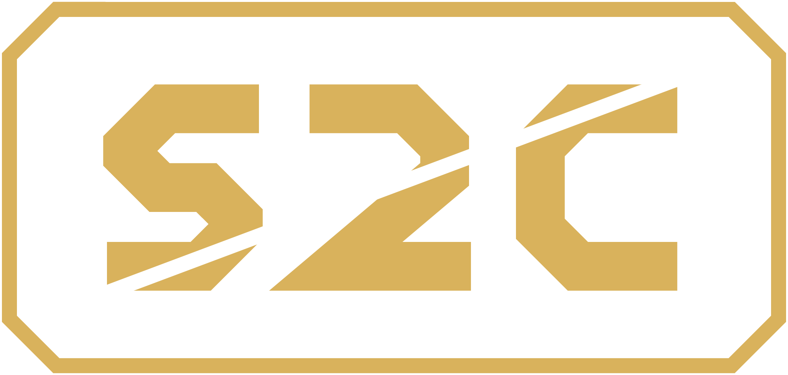

# S2C

Bilgisayarında çalışan, kişisel XAU/USD (altın) pratik ortamı.

Gerçek altın grafiği geçmişten rastgele bir anda açılır. Fiyat ve tarih gizlidir, sadece fiyat hareketine bakarak işlem yaparsın. Seans bitince gerçek tarih ve fiyat açıklanır.

Üstünde sanal bir prop firma katmanı var: değerlendirme hesabı alırsın, kuralları aşarsan hesap kapanır, hedefe ulaşırsan fonlanır ve sanal ödeme çekersin. Ne harcadığın ve ne kazandığın istatistikte görünür.



## Neler var

- **Grafik**
  - Kör replay: gerçek Dukascopy XAU/USD mumları, fiyat ve tarih gizli.
  - Gizli fiyat tek tıkla açılabilir.
  - 1–8 grafik bölmesi, 5 zaman dilimi.
  - Eksenleri sürükleyerek yakınlaştırma.
- **Emirler**
  - Piyasa, limit ve stop emirleri.
  - SL/TP isteğe bağlı. Grafikte sürükleyerek taşınır, tıklayarak düzenlenir.
  - Riske göre lot hesabı.
- **Hesaplar:** Sanal prop hesapları, BEM Funding kurallarını örnek alan programlar.
  - Günlük ve toplam zarar sınırı (sabit ya da takip eden).
  - Aşamalar, kârlı gün şartı ve tutarlılık sınırı.
  - Ödeme şartları.
- **Analiz araçları**
  - 64 indikatör.
  - Kategorili çizim araçları: kanallar, Fibonacci, pitchfork, pozisyon planlayıcı, ölçüm.
  - Takvimde NFP, CPI ve FOMC işaretleri.
- **Kayıt ve istatistik**
  - İşlem günlüğü: her işlemin grafiği, giriş ve çıkış görüntüsü, notlar, işlem tekrarı.
  - İstatistik: kâr/zarar eğrisi, performans takvimi, saat × gün ısı haritası, harcanan ve çekilen para.
- **Setup klasörleri:** Farklı stratejileri ayrı tutmak için.
- **Arayüz:** Tamamen Türkçe. Ses ve animasyonlar uygulamaya özel.

## Kurulum (Windows)

1. [Node.js](https://nodejs.org) LTS sürümünü kur (22 veya üstü).
2. Bu depoyu indir: **Code → Download ZIP**, sonra ZIP'i bir klasöre çıkar. Ya da `git clone` ile klonla.
3. Klasördeki **`S2C.bat`** dosyasına çift tıkla.

İlk açılışta gerekli paketler kurulur, bu bir kez olur ve birkaç dakika sürebilir. Sonra uygulama `http://localhost:5199` adresinde tarayıcında açılır.

- **Kapatmak için:** Açılan siyah pencereyi kapat ya da **`S2C-Kapat.bat`** dosyasına çift tıkla.
- **Güncellemek için:** Yeni dosyaları aynı klasöre çıkar ve `S2C.bat` ile aç. Uygulama değişiklikleri görür ve kendini yeniden hazırlar.

macOS ve Linux'ta aynı klasörde `npm run launch` çalıştır.

## Verilerin

Hesaplar, işlemler, günlük ve ayarlar **sadece senin bilgisayarında**, tarayıcının içinde saklanır. Hiçbir sunucuya gönderilmez.

- **Adres:** Veriler `http://localhost:5199` adresine bağlıdır. Başlatıcı bu yüzden hep aynı portu kullanır. Başka bir adresten açarsan uygulama boş görünür.
- **Tarayıcı:** Başka bir tarayıcıda açarsan veriler oraya taşınmaz.
- **Silinme:** Tarayıcı verilerini (çerezler ve site verileri) temizlersen kayıtlar silinir.
- **Yedek:** **Ayarlar → Yedekleme → Yedeği indir** ile düzenli olarak yedek al. Yedekten geri yüklemek ve başka bir bilgisayara taşımak da aynı yerden yapılır.

## Bilmen gerekenler

- **Veri kaynağı:** Mumlar, internet üzerinden Dukascopy'den (XAU/USD alış fiyatı) indirilir ve klasördeki `.cache` içinde saklanır. İnternet bağlantısı gerekir.
- **Piyasa saatleri:** Altın New York saatini izler: cuma 17:00'de kapanır, pazar 18:00'de açılır. Günlük mumlar da 17:00 New York'ta kesilir.
- **Spread ve kayma:** Mumlar alış fiyatıdır. Long işlemler satış fiyatından açılır, short işlemler satış fiyatından kapanır; aradaki fark **Ayarlar → Veri kaynağı → Spread** ile belirlenir (varsayılan 0,20 $). Spread sabittir, haber anındaki açılma ve kayma modellenmez.
- **Parça Setup:** Yalnızca kapanmış mumlarla hesaplanır, sonradan değişmez. Bölgeler 15dk, 1sa ve 4sa mumlardan gelir. Bu mekanik bir yorumdur; kazanç garantisi vermez.
- **Aynı dakikada SL ve TP:** Simülasyon stopu önce sayar.
- **BEM programları:** Firmanın 10 Kasım 2026'da yayımlanan şartlarına göre modellendi. Haber kısıtları, sembol başına risk sınırı ve ödeme incelemeleri bütünüyle modellenmez.
  - Kaynaklar: [BEM One](https://bemfunding.com/terms-of-use/bem-one), [BEM One Only](https://bemfunding.com/terms-of-use/bem-one-only), [Classic Normal](https://bemfunding.com/terms-of-use/bem-classic-normal), [Classic Swing](https://bemfunding.com/terms-of-use/bem-classic-swing).
  - Firma şartları değişebilir. Yeni hesaplar, açıldıkları andaki kuralları saklar.
  - Bu proje BEM Funding ile bağlantılı değildir. Gerçek para ya da gerçek hesap yoktur, yatırım tavsiyesi değildir.

## Geliştirme

```bash
npm ci
npm run dev        # http://localhost:5198 (geliştirme, ayrı veri)
npm test           # çekirdek testler
npm run typecheck
npm run build
```

`npm run test:browser`, Chrome kurulu bir bilgisayarda geçici bir profil, sentetik mumlar ve örnek hesaplarla uçtan uca test yapar.

## Lisans

[MIT](LICENSE)
